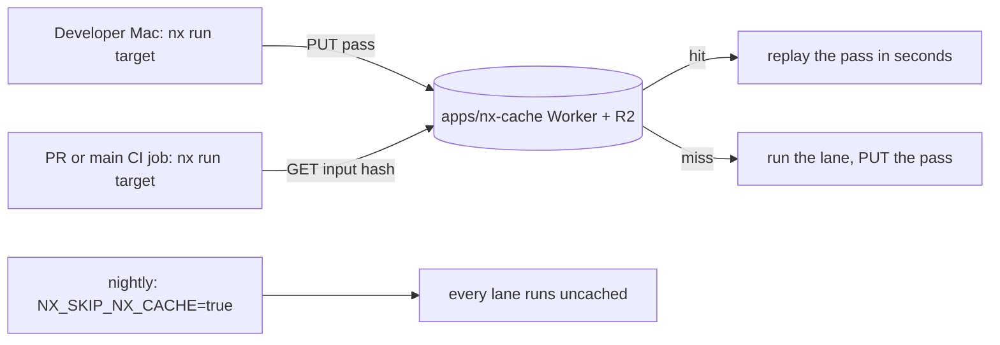

# Continuous integration

Every required check is an Nx target. A target's `inputs` decide its cache
key; a passing result for the same key in the shared Nx remote cache, whether
CI or the developer's Mac produced it, replays in seconds and satisfies the
merge gate ([ADR 0009](adr/0009-content-hash-merge-gate.md),
[validation policy](agents/validation.md)). Before any lane starts, the `Plan`
job compares the tree with the last green `main` run and starts only the lanes
whose tasks' inputs changed, so a documentation-only PR starts no test runner
([ADR 0014](adr/0014-path-routed-ci-lanes.md)). Merging to `main`
independently deploys the web Worker, including after a
documentation-only change; deployment never waits for post-merge CI.

`ci.yaml` holds the required checks and an optional purchase-import browser
lane. Validation exposes generation, tokens, TypeScript, lint, Knip, bindings,
tooling tests, routing drift and Worker tests as named
steps on one runner. Once setup succeeds, independent steps run despite earlier
check failures; their failures still fail the job. Cancellation stops further
work. The web matrix likewise keeps `fail-fast: false`. Formatting runs once in
the docs job. This collects distinct failures without paying a fresh install
for every static check. One status context, `CI passed`, owns the merge gate.
Tester Army coverage lives in `e2e-journeys.yaml` and runs only by manual
dispatch or explicit PR labels. `tester-army`, `tester-army:ios`,
`tester-army:import`, and `simulator-e2e` select only their respective lanes.
`tester-army-pr.yaml` dispatches a labeled, still-open same-repository PR's
exact head after CI passes. Labels persist across pushes; unlabeled changes
never launch journeys. Updates and closure cancel pending PR journeys.
There is no scheduled AI journey matrix. All journeys remain informational;
see [Tester Army](tester-army.md) for replay, evidence and timing limits.

## Cache keys and the remote cache

Cache inputs are declared in `nx.json` and each project's `project.json`.
Deferred MCP omissions are typed contract metadata; backlog wording is not a
generation input.



The required test lanes key on the `gate` named input in `nx.json`: every
non-documentation file (the lockfile and `.github/` included), the Markdown
that the Worker bundles (`docs/README.md`, the `docs/guide` pages, and the
purchase-import, product-enrichment, and
photo-inventory-import skills). Platform, Node version, locale, and `CI`
stay out, so a developer Mac's pass counts for the Linux lanes. Web targets add
ignored `.env*` files, the WASM their `dependsOn` builds, the preview-build
switch, and the variables that select or reorder tests (`webGate` in
`apps/web/project.json`); the Rust targets add `rustc -V`, because
`rust-toolchain.toml` names a floating channel. The Apple targets key on what
each native target actually reads (`appleHost` and `appleApp` in
`apps/apple/project.json`). Host tests read CubbyKit and its fixtures; app
compilation also reads app sources, resources and project configuration, but
not the host test fixtures. Both read the Rust FFI sources, build scripts and
CI configuration. JavaScript dependency hashes are excluded: generation owns
those dependencies and its output bytes are the native input. The generator's
artifact manifest selects the generated files to hash; missing files fail,
while unrelated ignored editor/build files never enter the key. Toolchain
versions remain outside the native pass key under ADR 0009's nightly backstop.
The Apple OpenAPI document includes only selected native operations and their
reachable components, projected by Redocly; the public HTTP document remains
complete. Unused HTTP contract changes no longer churn the native schema.
`pnpm apple check [host|app|lint]` prepares generated sources, probes cached
native passes, then prepares FFI only for misses. Full local checks run misses
sequentially. Swift formatting/state rules have their own cheap `apple:lint`
target and CI job with no FFI, SwiftPM resolution or app compilation.
When `Plan` selects the Apple
lane, the Linux `Apple cache probe` job probes both Apple passes in parallel
with the other lanes before scheduling macOS. A miss or unavailable probe runs
the corresponding native job; a skipped native job satisfies `CI passed` only
with its successful probe. Nightly runs force both native jobs. Workflows that only deploy,
publish or review (`deploy.yaml`, `deploy-nx-cache.yaml`, `apple-testflight.yaml`,
`claude.yml`) are outside every key. The nightly scheduled run sets `NX_SKIP_NX_CACHE` for
the whole workflow, so every lane, nested Nx calls included, runs uncached on
CI's platform, catching a failure that only Linux or CI's
toolchain shows; `main` pushes reuse the cache like PRs. The key is deliberately
broad. A false hit skips a check that should have run, so a target that starts
reading something new must have it in its inputs. A change to ordinary
documentation, a rebase that leaves the content unchanged, or a re-push of a
tested tree hits; any code change misses.

Use the documented Nx CLI and existing Actions for CI changes; do not build
hashing or cache-archive probes with private Nx APIs. The installed Nx has no
supported cache-only execution mode: a normal invocation restores a hit and
executes a miss. `--graph` shows the task graph, not a verified cached pass;
`--excludeTaskDependencies` skips prerequisites, not target execution.
[`nx affected`](https://nx.dev/docs/features/ci-features/affected) selects work
from changed inputs and does not prove a passing cache entry exists, so it
cannot replace this merge gate. The
[self-hosted cache API](https://nx.dev/docs/kb/self-hosted-caching) specifies
archive transport, not a cache-probe CLI; its archive format can change.
[`Nx Agents`](https://nx.dev/docs/features/ci-features/distribute-task-execution)
provide managed task distribution through Nx Cloud, requiring a separate
infrastructure decision. Linux lanes currently perform setup before Nx replay.
The existing Apple probe uses the normal CLI and a guard in `apple-check.sh`
that fails before native work on a miss.

Known gaps the nightly run covers rather than the key: the Worker bundles all
of `docs/**/*.md`, but only the Markdown listed above is in the web keys, so a
documentation-only change replays the browser and workerd lanes; and the Apple
key omits the Rust toolchain and FFI build settings, so a changed compiler
reuses an earlier Apple pass.

To let CI replay a local pass, run the lane exactly as its CI job does from a
worktree without ignored `.env*` files, for example
`CUBBY_E2E_SHARD=2/4 pnpm exec nx run @cubby/web:e2e` for each of the four
browser shards, `CUBBY_POSTGRES_SHARD=1/2` and `2/2` for `@cubby/web:postgres`,
and `pnpm apple check` for the Apple lanes. An unsharded run is a different key.

Nx's built-in HTTP remote cache (`apps/nx-cache`, a Worker over R2) is the
shared store. Nx connects when `NX_SELF_HOSTED_REMOTE_CACHE_SERVER` and
`NX_SELF_HOSTED_REMOTE_CACHE_ACCESS_TOKEN` are set: the developer's Mac sets
them in its shell, and in CI `setup-node-with-deps` exports them from the
`NX_CACHE_URL` and `NX_CACHE_TOKEN` repository secrets. A fork PR receives no
secrets, so both stay unset and its jobs use only the runner's empty local cache:
every lane runs, and nothing is written to the shared cache. Nx never caches a
failed task.

Nx fails a task on any remote-cache error other than a 404 miss, so
`setup-node-with-deps` first requests a missing entry and connects only on a
404; when the Worker is down or the token is rejected, the job warns and runs
its lanes uncached. The bucket expires entries after 30 days (an R2 lifecycle
rule on `cubby-nx-cache`). To rotate the token, run `wrangler secret put
CACHE_TOKEN` in `apps/nx-cache`, then update the `NX_CACHE_TOKEN` repository
secret and the Mac's `NX_SELF_HOSTED_REMOTE_CACHE_ACCESS_TOKEN`; jobs started
in between run uncached.

Project relationships (`implicitDependencies` and `dependsOn`) decide which
prerequisite targets run and in what order (WASM before its consumers, the MCP
App bundle before the web fast tests). Nx-inferred affected projects
(`nx show projects --affected`) remain a local convenience, not CI scoping.

## Deployment reuse

The web deployment job supplies the same Nx cache credentials as CI. Its
`wasm: restore` setup restores the complete content-keyed worker, browser and
cookbook packages, with a real build on a miss or unavailable cache. The cache
Worker's own deployment does not depend on itself. Web compilation stays fresh
for the merged commit: it embeds source identity and uploads source maps, so a
PR's `dist` cannot simply be deployed as main. Current-main checks remain both
before build and before publication.

## Local verification

`pnpm verify:local` is an optional local diagnostic; commands and when to use
it live in the [validation policy](agents/validation.md) and
[quality guide](agents/validation-quality.md). Facts that shape it:

- `--parallel=1` is deliberate: every tier is already parallel inside (vitest
  workers, Playwright workers, cargo, xcodebuild), and running tiers side by
  side on one host reproduces the contention that sequential tiers avoid
  — measured 2026-09-16, the web unit tier took 196s instead of 24s under
  `run-many`'s default parallelism and tripped a 5s test timeout.
- Selected targets replay from the Nx cache when their content is unchanged.
  The browser and workerd targets build the Worker inside their own command
  (`build-cf.ts --ensure`) rather than through `dependsOn`, because the
  `build-cf` key includes the Git commit for provenance and would rebuild before
  every replay.
- The textual order of the `run-many -t` list is not an execution-order
  contract; Nx dependencies provide the ordering (WASM before its consumers,
  web build before E2E). `verify:local:full` sets `NX_SKIP_NX_CACHE=true` so
  every target executes.

Commit hooks, push behavior, and the merge gate are defined in the
[validation policy](agents/validation.md).

Toolchain versions come from `.nvmrc`, the root `packageManager`,
`rust-toolchain.toml`, and the Apple setup action. Rust/wasm-pack, Apple
`container` on macOS (external PostgreSQL/IntegreSQL on Linux), and Playwright
browsers must be available; [test tiers](agents/validation-tests.md) cover database setup.
PostgreSQL remains the authoritative integration tier; Playwright defaults to
one worker on hosted runners and two on local macOS in `playwright.config.ts`,
the `e2e` target passes `--workers=2` for each shard. Both tiers reject an empty selection or an
unexpected skipped test without freezing the suite to a hand-maintained count;
a Vitest `-t` run accepts tests the pattern left out but still fails when the
pattern matches nothing or a matched test is skipped.
Browser verification always follows the current web build: the `e2e` target
runs `build-cf.ts --ensure` first.
The web build itself ensures current WASM and generated contracts before
bundling. Native CLI, test, and app commands ensure generated contracts before
compilation; artifact freshness belongs to these consumers, not Git hooks.

These cache and dependency changes reduce duplicate work and stale generated
artifacts, but do not promise that two simultaneous full verifications are
resource-safe on the same machine. Keep heavy local runs coordinated when the
host is constrained.

`pnpm apple check` runs lint, then uses the same cache-only guard as CI to
probe host tests and simulator compilation before FFI preparation. A miss
fails before native setup and is never cached. `apple:host-tests` runs
CubbyKit's package tests and the OpenAPI warning gate; `apple:simulator-build`
compiles `Cubby-iOS` for a generic simulator and caches the built app. Neither
boots a simulator. The independent `apple:lint` target runs Swift formatting
and the state-initialization rule. Missing Xcode is a failure, never a cached
successful skip. Build scripts retain the same native arm64 profile, package
pins and artifact preparation for local and hosted checks.
The `rust` target runs fmt/clippy/test per
crate (`recipebridge/project.json`, `cubby-ffi/project.json`). Clippy and tests
use the root workspace's `ci` profile: no debuginfo, incremental compilation,
or dependency optimization. These tests run in under a second; the development
profile's optimized dependencies add compilation work without useful runtime savings.
Cargo still needs check metadata and linked test artifacts, and the default
and browser/native feature sets remain separate checks. Both targets share
`target/ci` and run sequentially to avoid Cargo's target-directory lock.
Their broad `gate` inputs include the root profile and workflow; `rustc -V`
still keys the floating compiler.

The Rust job uses an explicit, pinned `Swatinem/rust-cache` step with prefix
`rust-gate-v3`; its key also hashes root `Cargo.toml`, because rust-cache hashes
member manifests but omits the virtual workspace's profiles. The job installs
only the root workspace (`workspace-filter: cubby`), which provides Nx without
installing the web packages or running their generator. The Nx Rust targets
compile their required dependencies when they run. CI does not run a
separate Clippy/`cargo test --no-run` population pass before Nx: that repeated
the targets' compilation and could spend time compiling even when Nx already
had a passing result. Only successful jobs save new compiler-cache entries.
A job that replays every target may save a small compiler cache; that affects
later compilation speed, not the validity of Nx's cached pass.

`cubby-ffi` and the WASM packages share the `recipebridge` Rust core and Cargo
lockfile, but each target needs its own compiled artifacts. EPUB extraction is
the separate wasm-only `recipebridge/cookbook` crate, and `cubby-ffi` turns off
`recipebridge`'s Worker-only default features (`html`, `ai-usage`), so Apple
targets compile neither the cookbook crate nor `page.rs`. The `rust` target
also lints `recipebridge --no-default-features`, the browser build.
The unused local Rust model-pricing export is removed; Cubby usage pricing
reads `models.dev` in TypeScript. Cookbook's upstream pricing table remains
transitive until the [pricing consolidation](todos.md#ai--search) is completed.

`apps/apple/project.yml`'s `Cubby-iOS` scheme also lists CubbyKit's own tests
as a local package test target (`package: CubbyKit/CubbyKitTests`), so
`xcodebuild test -scheme Cubby-iOS` on a simulator runs both `Cubby-iOS-Tests`
and CubbyKit's package tests together — useful locally, but hosted CI does not
use it (see below). `apps/apple/CubbyKit/Tests/CubbyKitTests/VisionHardware.swift`
defines a `.requiresVisionHardware` trait that skips Vision-dependent
contracts (`SubjectLift`, `FeaturePrintIndex`) when running on the Simulator,
for whichever caller — local or hosted — ends up running that scheme there.

Two hosted macOS jobs, `Apple host tests` and `Apple simulator build`, run in
parallel when the Apple lane is selected and its Linux probe did not verify a
cached pass. The probe runs each Nx target with `CUBBY_NX_CACHE_PROBE=1`: Nx
replays a cached pass for the same input hash, and on a miss the script fails
before building (Nx never caches that failure). Only a miss or failed probe
pays for a macOS runner, which installs the workspace (generating the Swift
inputs), the FFI, XcodeGen, and Xcode build caches, and runs the target. The
nightly run skips the probe and runs both with `--skip-nx-cache` on the
runner's own Xcode.
The host job runs the automatically generated
`CubbyKit-Package` scheme with `xcodebuild test` on the ARM macOS host — no
simulator. The aggregate package scheme includes all CubbyKit tests and the CLI
product; the library-only `CubbyKit` scheme has no test action. The command uses
`-onlyUsePackageVersionsFromResolvedFile` to keep the committed package pins.
Its `xcode-host-v1` cache stores `apps/apple/CubbyKit/.build`, including the
Xcode compilation cache and dependency checkouts under `.build/xcode` and the
SwiftPM warning-generator products. Xcode's `Build` and `Logs` directories are
excluded: tests rebuild products from cached compiler results rather than
restoring timestamp-sensitive objects and test bundles. Keys include the Xcode
toolchain, package pins, CubbyKit sources, and warning-check script. It then
runs `apps/apple/scripts/check-openapi-warnings.sh`, which fails on any
swift-openapi-generator warning (a schema the `CubbyAPI` build plugin would
silently drop). A successful warning check records its content key inside
the cached `.build` directory; unchanged document, config, generator pin,
toolchain, and check script reuse that pass without rebuilding or regenerating.
Changed inputs run the full check, and warnings or generator failures never
record a pass. The simulator job restores its simulator-only FFI framework and
runs the generic-simulator build with no tests or simulator boot. Both jobs
use `!cancelled()` so whole-workflow cancellation can stop them while a failed
probe still falls through to macOS.

Each SDK keeps its own compilation cache. Parallel jobs use two macOS
runner slots to avoid adding the host and simulator compile times after a
cache miss or source change. A generated-schema change still recompiles the
client for each SDK; neither cache reuse nor a five-minute ceiling is guaranteed.
The generated `CubbyAPI` target forwards `-gline-tables-only` directly to the
Swift frontend, so the driver's default `-g` does not restore full debug type
information. Handwritten Swift targets retain their normal debug information.

The Xcode project and host package-test command enable Apple's compilation cache
and its hit/miss remarks. Content-addressed results live in
`DerivedData/CompilationCache.noindex` for the simulator and
`CubbyKit/.build/xcode/CompilationCache.noindex` for the host, inside their
successful-build caches. This can replay compiler work when
ordinary build products need rebuilding but the compiler inputs are unchanged;
new source inputs still compile. Local `swift test` remains available and does
not use this Xcode cache.

Manual native E2E installation (`apps/web/tooling/sim-e2e.ts`) also runs
`apple:simulator-build`, restoring unchanged apps from Nx. Check those callers
when removing a shared build helper.

The earlier simulator-test job ran `xcodebuild test` on a concrete simulator:
first boot cost about 6 minutes plus roughly 10 minutes of CPU starvation
(a 5s script took 2.6 minutes, and compilation doubled). Host tests and the
generic-simulator app build keep that simulator work excluded.
`.github/actions/setup-apple-tools` installs XcodeGen and restores
`apps/apple/SourcePackages`, the `xcodebuild`-resolved SPM clones for Sentry,
GRDB, Nuke and swift-openapi-generator (previously an uncached "Resolve Package
Graph" on every run), used by `Apple simulator build`. It is separate from the
target-specific FFI output cache (`.github/actions/setup-apple-ffi`) and the
host job's build cache described above. DerivedData keys explicitly exclude
the host `.build` directory; its compiled products are not simulator source
inputs. Host and simulator caches have separate Xcode toolchain and package
graph keys. Dependency declarations live in XcodeGen’s included
`apps/apple/packages.yml`; app versions and build settings stay in the product
key, so a version bump does not discard dependency precompiled modules. A
package declaration, local Swift package graph, or resolved-pin change still
invalidates those modules. App pins live in `apps/apple/Package.resolved`;
Kit pins remain in `apps/apple/CubbyKit/Package.resolved`. Simulator dependency
cache keys include both lockfiles and both specs.

Compiled Apple caches are published only after successful work. GitHub cache
entries are immutable: an interrupted compile saved under the final key makes
later exact hits repeat unfinished work. Cache-generation names and keys belong
in the setup actions. Retire obsolete generations and merged PRs' private entries
with GitHub's cache controls after main is seeded; retain active PR/current main
entries. Dependency clones remain advisory; warm restores establish reuse,
not a required-check runtime guarantee.

## Hosted suite

The `CI` workflow runs automatically for pull requests to `main` and pushes to
`main`. Superseded PR runs are canceled. Closing or merging a PR also cancels
its remaining CI: the closure run shares the PR's concurrency group but skips
all jobs, including `CI passed`. The group retains the PR number when a merge
changes the event ref to `main`, keeping main's push run independent.
Main runs finish rather than being
canceled by later merges, so native checks can publish reusable caches.
GitHub concurrency keeps
one main run active and at most one pending; a newer push replaces the pending
run. This does not add parallel main runs or jobs. The newest main CI result may
wait for the active run; deployment remains independent.

`Plan` runs on the `ubuntu-slim` container runner. It rejects live entity
codes in PR text, finds the commit of the newest successful `main` push run of
`ci.yaml`, and runs `dorny/paths-filter` with git (`token: ""`) on the
two-dot diff from that commit to the tested tree, matching
`.github/ci-lanes.yml`. `scripts/ci-lanes.ts` generates that file from the Nx
inputs of the tasks each lane runs (`LANES`), resolving named inputs,
`dependentTasksOutputFiles` producers, each task's own configuration, and the
runtime inputs classified by exact command; an unclassified runtime input
fails generation, and `cubby-checks:ci-lanes` fails when the file is stale.
`scripts/ci-lanes.test.ts` asserts that every file Nx's hash plan reads for a
lane's tasks selects that lane, and that every Nx task a lane's `ci.yaml`
commands run is one that lane routes. Any deleted or renamed file also
selects the docs lane, because it may be a relative link's target. `Plan`
runs the outward-text check on the slim image's own Node 24, without
`setup-node`; a missing or older Node fails `Plan` closed. Any tree compared with a green tree is
correct, ancestor or not: a lane whose inputs match would replay that tree's
pass. Nightly and manual runs, and a repository with no green main run, start
every lane. Lanes with identical groups share one filter entry, named
`<lane>+<lane>.<n>`. `Plan` outputs the selected lanes, the matrix of web
lanes, and the exact jobs it skipped.

`CI passed` is the single required check (`re-actors/alls-green` on
`ubuntu-slim`). It needs every lane and fails on any failure or cancellation,
and on any skip other than the jobs `Plan` skipped or an Apple job whose probe
verified a cached pass, or the live Email decision job on a fork PR without
secrets. Trusted runs always call Jev and Clef on the synthetic Email suite
through the real gateway; this uncached job uses `AI_GATEWAY_API_KEY`. Real
member inputs are refused in CI. A failed probe is allowed: it only sends both Apple
lanes to macOS.

`Validation` runs the cached generate, design-token, types, lint, Knip,
CI-lane, bindings, script-test and Worker-test targets as individual steps.
`pnpm check:all` runs those targets plus formatting locally.
Dependency advisory audits and deduplication are not CI or local validation
gates; dependency maintenance is handled separately from code validation.
`Docs and formatting` runs on `ubuntu-slim` with a root-only install: the
`format` target and the offline relative-link check through the pinned Lychee
action, a composite action that downloads the Lychee binary (no Docker).
Paths written as inline code are informational; link a repository file when
its existence should be checked.

`setup-node-with-deps` installs from the registry without a pnpm store cache:
measured restore/save cost exceeded fresh install cost. With `wasm: restore`
it replays Nx's WASM artifact from R2, outside the Actions cache, and builds
with the runner's Rust only on a miss. Compiler and SwiftPM caches are separate.

Generated output is never committed, except `.github/ci-lanes.yml`, which
`Plan` reads before any install; web and Apple jobs generate it during
`postinstall`. The Rust job's root-only install skips web generation, and
`Validation`'s `generate` gate checks that it generates cleanly and that the OpenAPI
document lints.

The `lanes` job is one dynamic matrix over the selected web lanes, one
standard runner per entry; only database entries start the PostgreSQL and
IntegreSQL service containers (an empty service `image` starts none).
`Auxiliary tests and builds` runs `nx run-many -t test`: every auxiliary
package's tests and the `unit`, `mcp-contract`, `worker-safety`, and `ui`
Vitest projects of the web app, each a cached target. Node projects run first,
then UI uses Vitest's standard project group ordering, keeping each phase's
worker environment together. `Build Workers and runtime tests` runs the
`db-check` migration drift check against disposable scratch databases and the
`integration-workerd` Vitest project against a Worker it builds itself.
Desktop Chromium runs as four Playwright shards (two workers each) through the
`e2e` target, each building the Worker with the run's source commit and branch
provenance. Phone-web and WebKit browser coverage was removed from PR CI and the
Playwright suite; native checks remain separate. There is no coverage mode.
The disposable PostgreSQL container uses `fsync=off`, `synchronous_commit=off`,
and `full_page_writes=off`, matching the local test-service settings. These
[standard non-durable settings](https://www.postgresql.org/docs/17/non-durability.html)
remove disk durability work from synthetic test data; CI does not test database-server
crash recovery. SQL constraints, transactions, and the full reset still run.

CI records a Playwright trace only for the retry of a failed test
(`on-first-retry`), so passing tests pay no tracing cost; local runs keep
failure traces. Each browser job uploads Playwright's HTML report and those
traces for seven days, named by commit SHA and shard. CI runs use only
synthetic data and test credentials, so the report is safe to publish. Local
runs, including the manually dispatched native simulator E2E, keep their
reports, traces, and run bundles local because they may contain household data
or credentials.
`E2E tests (purchase import agent, optional)` runs the Playwright project of
that name (`purchase-import-run.spec.ts`: the purchase agent with a scripted
model and gateway, driven through the browser) through the
`e2e-purchase-import` target, building its own Worker. It is informative only:
it is outside `CI passed` and `continue-on-error`, so its failure leaves the run
successful. It uses the same `webGate` key as the
other web lanes and uploads the same Playwright report.
The `integration` Vitest project runs as two `postgres` target shards
(`CUBBY_POSTGRES_SHARD`, Vitest `--shard`), each with four fork workers. The
`integration-workerd` project (the files that start the built Worker, listed in
`workerdIntegrationTests` in `apps/web/vitest.config.ts`) runs in `Build
Workers and runtime tests`. A workerd consumer missing from that list runs in
an ordinary integration shard and fails there, because in CI the harness
refuses to rebuild a missing or stale Worker. Jobs that need the databases
declare native GitHub Actions service containers; a YAML anchor reuses the
pgvector PostgreSQL and pinned IntegreSQL definitions. GitHub owns the network, container
startup, PostgreSQL health wait, logs, and cleanup. PostgreSQL also maps port
55432 for guarded named-database tests. `POSTGRES_INITDB_ARGS` sets the disposable
settings in the fresh PostgreSQL 17 configuration. IntegreSQL retries its
PostgreSQL connection during startup; its pinned distroless image has no
`/bin/sh` for Docker shell health checks. The optional purchase-import and
Tester Army Linux lanes use the same service definitions. The
`@claude` mention workflow (`claude.yml`) remains on demand; a new mention on
the same issue or PR supersedes its previous response, while unrelated comments
do not cancel it. There is no automatic PR review workflow. Preview deploys
were removed; production is the only deployed environment.

## Apple TestFlight release

Normal merges to `main` wait for the nightly check at 10:17 UTC. It publishes
current `main` when files that can reach the app changed since the last complete
upload (the workflow's inline `full`/`apple` path filters),
or that upload is at least 30 days old. A changed
`APPLE_CLIENT_COMPATIBILITY_VERSION` in `packages/shared/src/apple-client-version.ts`
publishes promptly; comment-only edits do not. The shared value supplies both
the generated `MARKETING_VERSION` and server minimum. Bump it for wire-breaking
changes; compatible changes need only a new CI build number.

For an immediate build or retry, dispatch a fresh run:

```sh
gh workflow run apple-testflight.yaml --ref main
```

Publishing uses one pinned current-main commit, increasing build numbers, and
one active workflow. Reruns are refused, including checkpoint-only retries.
Each platform archives, verifies, and uploads on its own macOS runner. Only
both uploads succeeding records the upload as an immutable annotated tag,
`testflight/<version>-<build>`, on the uploaded commit, its message the
checkpoint JSON (`sha`, `version`, `build`, `uploadedAt`); only that job has
`contents: write`. The highest build among those tags is the last complete
upload, and `git tag --list 'testflight/*'` is the upload history. No-op and
partial releases do not advance it. No tag rebuilds; a malformed or
lightweight tag fails the plan. A partial failure's next fresh run rebuilds
both platforms.

Uploads are internal-only with automatic group distribution. Verify processing
and installation in TestFlight after publishing: upload acceptance alone does
not establish availability. Server deployment remains immediate, so breaking
changes can leave an update-required period until the new app is installed.

After a long pause, manually re-enable scheduling and dispatch a fresh build.
GitHub can disable public-repository schedules after 60 inactive days; the
30-day refresh does not prevent this.

## Deployment

`.github/workflows/deploy.yaml` deploys the web Worker on every `main` push,
without waiting for post-merge CI. Required PR checks gate merging. It uses
`.github/actions/deploy-worker` to check current main before building and again
before deploying, preventing stale web deployments. The build runs once;
Wrangler deploys `dist/server/wrangler.json` directly.

`.github/workflows/deploy-nx-cache.yaml` deploys the Nx cache only when its
source/configuration, dependency inputs, Node version, setup action, or its own
workflow changes. Manual dispatch can retry a deployment. It checks out current
`main` when the serialized job starts, so rerunning an old workflow cannot
roll the service back and a later docs-only push cannot suppress a pending
cache change. It uses a filtered install and plain `wrangler deploy` on
`ubuntu-slim`, with no separate build step. Both workflows keep credentials in
the deployment step's environment and serialize their own service deployments.

## Branch protection and measurement

The `main` ruleset requires only `CI passed`, from GitHub Actions. Keep `strict` disabled so
a green non-conflicting branch need not rebase, allow administrator bypasses,
and do not require human review.

Record ten public PR runs before changing topology: queue time,
required-check p50/p95, per-lane duration, cache behavior, cancellations, and
merge-to-deploy duration. The target is a 4–7 minute warm critical path and no
more than 10 minutes cold. Optimize only a measured bottleneck; prior evidence
already rejects node_modules caching. Track queue and
cold native builds separately; the target is not a measured runtime guarantee.

### Retained experiment conclusions

Collect naturally occurring successful PR runs before claiming a new median.
Compare queue time, required-check p50/p95, cache misses, cancellations,
job-minutes, and merge-to-deploy time. Historical experiment tables and run
links remain in Git history.

- More browser workers increased navigation latency and cumulative case time
  without a reliable critical-path gain. Shard counts and worker settings live
  in the workflows and Playwright configuration.
- Fast projects share a job to reduce runner demand outside the browser
  critical path. Each browser shard and the workerd job build their own Worker:
  a separate build job would add startup and install prerequisites.
- HTTP/2 proxying and WASM preloading did not improve end-to-end hydration.
  `context.route` asset caching disabled Chromium's HTTP/code cache and made
  navigation slower. Catch-all chunk grouping caused module initialization
  cycles; strict execution order stalled hydration. Fewer chunks needs a
  renderer-boundary refactor, not a bundler toggle.
- Playwright's fully-parallel sharding takes contiguous equal-count slices;
  one slow case stays on one shard. Keep cases short using page clocks or
  responses rather than poll intervals, instead of reordering specs.
- Local full verification runs tiers sequentially because each tier already
  parallelizes internally. Concurrent full runs caused contention and timeouts.
- Cache dependency artifacts when build savings exceed transfer costs. Store
  and `node_modules` caching lost to registry installation.

## Operational checks

Choose workflow/routing checks under the
[validation policy](agents/validation.md#before-opening-a-pr); workflow edits
use `actionlint`, and `pnpm check:plan` explains selected lanes without asking
for a broad local suite.

After a material workflow change, compare at least ten representative runs for
PR p50/p95 wall time, merge-to-deploy time, total job-minutes, cancellations,
and cache behavior.

## Additional Tester Army web coverage

The existing `e2e-journeys.yaml` manual dispatcher includes visual baselines and
bounded authenticated exploration. These use the existing model setup, reports,
synthetic harness and evidence uploads. They do not change the required gate.
See [web coverage additions](tester-army.md#web-coverage-additions).
