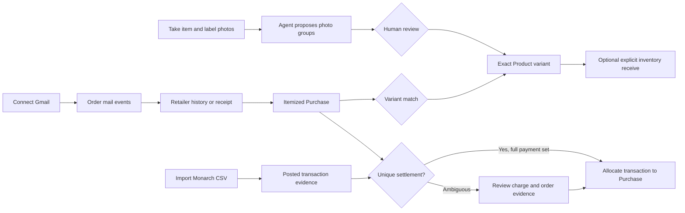
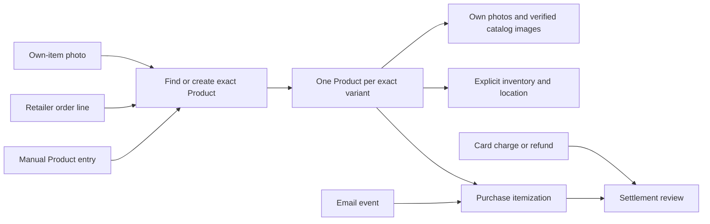
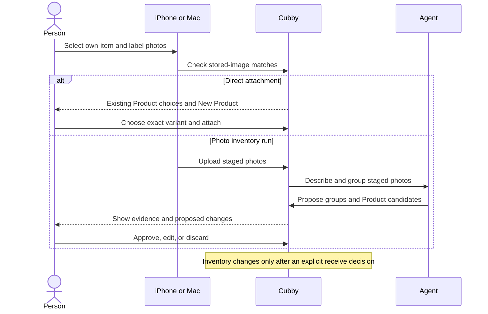

# One product, however its evidence arrives

A Product is Cubby's record for one exact item variant. A black small shirt and
a navy small shirt are different Products. Two physical copies of the same
black small shirt share one Product; their inventory quantity records the
copies. A Product can exist before Cubby knows its purchase, before it has a
photo, or before anyone decides where it is kept.

The goal is simple: starting from a photo, a retailer order, an email, a card
transaction, or a manual entry, a person can reach **one well-identified
Product** with the right evidence attached. The entry point and sequence do
not change what the result means.

## The whole journey

Connect read-only Gmail in Cubby Settings, import a Monarch CSV through the
web or native statement review (or MCP), and capture own-item and label photos on iPhone or Mac.
These sources can arrive in any order. Cubby should converge them on one exact
Product, an itemized Purchase, and a truthful settlement allocation. A human
reviews uncertain identity, grouped photos, and ambiguous charges. Pi interprets retained Email for unattended Mail import. Browser research and
Product enrichment are member-directed [Burn-down](burn-down.md), using Claude
or Codex and ordinary source-backed writes. Photo grouping proposes changes
for review; neither an agent nor a decision model substitutes for source
evidence or approval.
Every
order is household spending, but not every line is a stocked item: the import
resolves prepared food, tickets, rides, donations, and paid labor or delivery
as `expense_only` (no Product); software and subscriptions the household
tracks or that ship goods keep their Product. A spending category with
`productExpectation: not_allowed` (Restaurants) neither expects nor accepts a
Product: every write that would leave a Product on such an Expense is refused
(`repo/inheritance-validation.ts`), and a line-level category override is the
way out. `not_expected` (Groceries) only drops the missing-Product gap. A
delivered order asks to be received only when a principal line has a Product
or its category allows a Product and the Purchase still has an open
import-review finding (unresolved goods, a pending itemized replacement, a
totals mismatch); productless lines with nothing left to review were booked
expense-only, and a restaurant meal is never goods.

A registered identifier has one Product owner. Accepted order lines retain
their actual Product bindings. A raw receipt SKU establishes association; its variant granularity remains unknown. Explicit ASINs can support exact identity. A raw SKU stays a ranking clue even when current Sources corroborate matching size, color and pack: other relevant dimensions can differ. A shared model/style identifier stays a ranking clue. Current title facts become verified size, color or pack evidence only when a Source supports that current value and explicitly corroborates the fact. A confirmed variant contradiction under an exact claim exposes a conflict
without assigning the identifier twice. Shared URLs and partial variant words
remain clues for review.

The statement does not identify an item, and a photo does not prove where it
was bought. A delivered email and a card charge do not receive inventory.

### Coverage and remaining work

The [local journey coverage map](../agents/core-journey-e2e.md) owns executable
checks and their limits; the [work list](../todos.md) owns remaining software
and live acceptance. A deterministic import test does not verify live Gmail,
retailer changes, model quality or physical-device background behavior.

The [shared photo skill](../../.claude/skills/photo-inventory-import/SKILL.md)
and [purchase skill](../../.claude/skills/purchase-import/SKILL.md) apply to
the import-run agent, Codex, and Claude. They encode source boundaries and review rules, not
one model's private prompt.

### Photo inventory review

Choose **Cubby / Pi** or **Claude / Codex** for each photo Run. Cubby starts
grouping after all admitted upload batches finish and required descriptions
settle. The external path provides a copyable prompt once the photos are ready;
it does not start Pi. Neither path creates Products or receives inventory until
the member approves proposals.

Review groups in one continuous scroll. The item index jumps to a group;
**Select all ready items** selects eligible proposals, and **Approve selected
items** remains a separate action. Blocked groups stay in review. Descriptions
and recognized label text are available under disclosure rather than filling
the main review surface.
Cards load as they approach the viewport and retain unfinished edits after
scrolling away. Approved and discarded details stay collapsed until opened.

Proposal values name their last recorded writer. They are not Jev/Clef field
suggestions. Product identity detection reads every live Product through durable AI refresh work; review surfaces read at most 200 stored pair Assessments per queue read. A nonexact model verdict of distinct variants resolves its assessment without universal suppression; revised evidence or policy remains assessable. Retained Source URLs retrieve ranking candidates even when names differ; they never establish exact identity by themselves. Migrated pair records with unknown fingerprints remain historical/read-only until current evidence is reassessed. Exact identifiers and verified variants carry the decision evidence. Related pairs can share a group, but review applies one independently assessed pair at a time. Older proposals whose
writer was not recorded say so. Manufacturer is text on a Product, not a
separate record; existing-name counts help reuse the catalogue's spelling.
Category and destination pickers show the selected record's representative
image before another search is needed.

Adding a new batch to a Cubby Run replaces all unapproved proposals and member
edits when regrouping. Approved and discarded groups remain fixed. State this
next to the add-photos action. Claude/Codex Runs wait for that session to regroup.
Completed Runs can accept new batches. If a Cubby grouping session has been
archived, start a new import instead; its approved Products remain available
for matching.
Skipped photos retain their original Image and Run evidence, with a visible
reason; approval does not attach them to the Product or count them as inventory. A failed
description can be retried, or explicitly skipped to continue with other photos.

**Import results** lists distinct created and matched Products and their
inventory outcomes. The Changes section keeps the separate chronological audit.

## What a successful journey looks like

1. **Identify the item.** Compare brand, model, distinguishing features,
   color, size, and any exact identifier. A label's letter must be interpreted
   in context: a fit mark can be separate from the boxed size. An unreadable
   field stays unknown; it does not become a guess. Exact variants take
   priority over a Product merely because it has fewer photos.
2. **Find an existing Product before creating one.** Search identifiers and
   aliases as well as names. A purchase-created Product with no own photo is a
   good candidate for a later photo. A photo-created Product without a
   purchase is a candidate for a later order. A vendor-imported image does not
   mean the item has already been photographed at home.
3. **Keep provenance visible.** Own photos, labels, retailer catalog images,
   order lines, mail events, and statement transactions are different kinds of
   evidence. A matching amount and date are a settlement candidate, not item
   identity. A generic email subject is an event clue, not an itemized order.
4. **Review ambiguous identity.** An identifier that names one exact variant
   may connect a new order line to an existing Product; a style or family
   number shared by sizes or colors only ranks candidates. A Product named
   exactly as the order line, with no recorded field contradicting it, is
   that line's Product. A merely similar descriptive match is proposed for
   review. If two variants remain plausible, show both and the distinguishing
   evidence. If duplicate Products already exist, the merge preview shows
   which scalar values survive, which values are filled, and which images and
   relationships combine before the person confirms.
5. **Record ownership deliberately.** A photo group can attach to a Product
   without an inventory entry when owner or location is unknown. An order can
   be imported without receiving inventory. Neither a delivered email nor a
   charge changes inventory on its own. Returns and refunds update purchase
   and settlement evidence; they do not silently remove a household item.

## Entry points

| Start                       | Short path to the Product                                                                                                       | Human decision                                                                            |
| --------------------------- | ------------------------------------------------------------------------------------------------------------------------------- | ----------------------------------------------------------------------------------------- |
| iPhone or Mac photo, no run | Check for the same stored image, choose an existing Product or create the exact variant, then attach the photo with its role.   | Confirm the Product and, separately, whether to add inventory.                            |
| Photo inventory run         | Upload photos; the agent proposes item and label groups and existing Product matches; review each group.                        | Approve, edit, or discard groups before Product or inventory writes.                      |
| Retailer history or receipt | Capture stable order identity and exact itemized lines; resolve each line to a Product or a reviewable candidate.               | Resolve uncertain variants and any purchase findings.                                     |
| Gmail                       | Read-only discovery retains related/uncertain Email; Mail import interprets admitted originals into orders and lifecycle links. | Approve the specific import/discovery scope; inspect uncertain relevance and order links. |
| Card or export transaction  | Match a real posted charge or refund to its order or orders.                                                                    | Confirm ambiguous allocations; never invent a balancing transaction.                      |
| Manual Product creation     | Search existing Products, create the variant, then add photos, purchase, or inventory later.                                    | Confirm identity and optional inventory.                                                  |

## Evidence traps from a synthetic wardrobe case

The [regression corpus](../../apps/web/tests/fixtures/product-identity-evidence.ts)
uses the fictional **ForgeWear** black small pocket tee.
Its own label has a fit mark and a separate boxed size. The catalog also has
navy small, white small, and black medium variants. A saved retailer page is
duplicated, an earlier trial order lists the same item, and the trial's final
email lists that item among the returns while charging for other retained
items. A later two-item order has an email subject without the brand, and
overlapping card exports repeat a combined charge. Another nearby charge has
the same amount. An order-page listing or trial charge alone cannot establish
that the photographed item was purchased in the trial.

The expected result: black small ranks above the other variants even if it
already has an own photo; the reviewer can attach the new photo to that
Product; the duplicate page creates no duplicate Purchase; the trial order
does not establish ownership for a returned trial item; repeated statement
rows create no duplicate transaction; and settlement remains unresolved until
the specific charge and order relationship is supported. This scenario is
fictionalized from local evidence. Raw exports and saved pages stay outside
the repository.

## How to check the journey

The [local journey coverage map](../agents/core-journey-e2e.md) names each
executable Product path, its actual synthetic input, the few seeded
prerequisites, and its remaining gap. The wardrobe check carries uploaded
photos, synthetic retailer HTML, and a browser-uploaded Monarch CSV through grouping, approval, purchase import,
settlement, and Product merge. A separate browser check creates a Product from
item and label files without an import run. On iPhone, repeat direct photo and
new Product paths in a disposable local database; inspect candidate order,
taps, review language, and final Product detail. Record a simulator or browser
video when interaction quality is the question. Keep real household evidence
in local analysis only.
