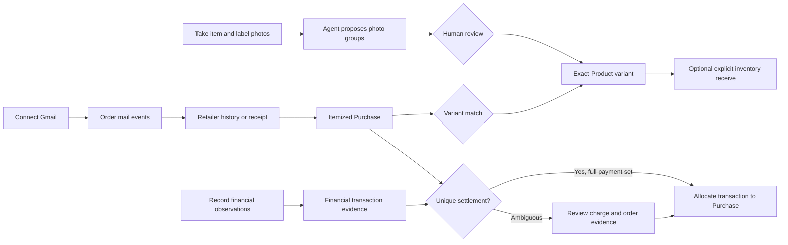
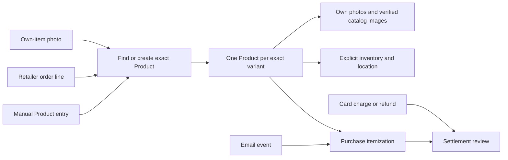
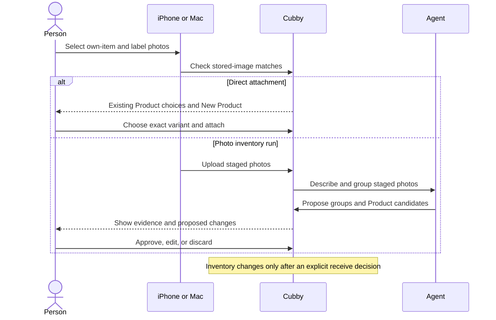

# One product, however its evidence arrives

This is the Product branch of [Evidence arrives in any order](import-journey.md).
That journey also covers financial events with no Product, including transfers
and reimbursements. [One view of the work](work-queue.md) owns executor routing
and the shared explanation of prerequisites and effects.

A Product is Cubby's record for one exact item variant. A black small shirt and
a navy small shirt are different Products. Two physical copies of the same
black small shirt share one Product; their inventory quantity records the
copies. A Product can exist before Cubby knows its purchase, before it has a
photo, or before anyone decides where it is kept.

Add to inventory counts Products in its submit label, explicitly naming that
unit. Each Product row's quantity and unit determine the stock added; adding
four copies of one Product still submits one Product.

The goal is simple: starting from a photo, a retailer order, an email, a card
transaction, or a manual entry, a person can reach **one well-identified
Product** with the right evidence attached. The entry point and sequence do
not change what the result means.

## Photo capture and review

A new belongings import on Apple defaults to owned items and the Run member.
Storage location is optional during capture; structured intent and destination
travel with the Run to both agent paths and web review. The native handoff links
to that same Run's Photos section. Uploading and grouping do not create stock.
Missing receive destinations block approval and can be filled once for pending
receive groups on web, without replacing an item-specific destination or an
explicit reference, already-counted or historical choice. Additional photos and
labels never increase quantity. A Product match alone does not prove another
physical copy.

Ready item details remain available in the compact review workbench; genuine concerns open for review.
The web can apply all ready groups directly or a selected subset, with Product
and stock effects visible before approval. Autosave barriers, revision checks
and independent batch failures remain in force. Resolving an identity concern
joins the save barrier and publishes its confirmed review snapshot before the
next field edit can save.

Photo Brand evidence names its supporting images and exact live Vendor name/alias
matches. A single unambiguous marketed-label match prefills a new Product draft; it can stage an existing Product correction without applying it. Unknown names require an explicit Brand claim or member
entry. Choosing a new Brand stores `brandCreate` in the proposal and creates or
reuses the exact Vendor only inside the approved Product transaction. Multiple
exact matches require the member to choose one. Rejections follow photo lineage;
an agent cannot replace a member-edited group or regroup its images.

Selected changes to an existing Product publish inactive field Suggestions:
they retain evidence and review identity without entering automatic application.
Approval writes the selected fields and records the generic `saved_field`
acceptance receipt in the same transaction. Rejecting a linked Brand proposal
records a decision on the Suggestion as well as the photo evidence rejection.
Unchanged candidate values retain their original Suggestion and input fingerprint
through sibling draft edits. Approval locks and checks the retained Product inputs
before any write; changed selected photo evidence or a later member correction
requires clearing and reselecting the proposed field after review rather than an
automatic rebase. Proposed new Brands retain the same before-input fence until a
Vendor exists. Refreshing cannot revive a rejected correction. A member who clears
and explicitly selects that Brand again creates a fresh decision revision, while
the earlier rejection remains history. Weak retailer/provenance text and short
alias matches stay available as choices without prefilling Brand. Brand creation, Product changes, photo attachments
and optional stock remain one approval transaction; per-group failures preserve
successful siblings and the existing operation replay receipts.

## The whole journey

Connect read-only Gmail in Cubby Settings, record Monarch financial evidence
through the agent financial-evidence-import skill, and capture own-item and label photos on iPhone or Mac.
These sources can arrive in any order. Cubby should converge them on one exact
Product, an itemized Purchase, and a truthful settlement allocation. A human
reviews uncertain identity, grouped photos, and ambiguous charges. The
[shared work model](work-queue.md#choose-the-executor) routes import execution
and interactive research. Photo grouping proposes changes
for review; neither an agent nor a decision model substitutes for source
evidence or approval.
Every
order is household spending, but not every line is a stocked item: the import
resolves prepared food, tickets, rides, donations, and paid labor or delivery
as `expense_only` (no Product); software and subscriptions the household
tracks or that ship goods keep their Product. A spending category with
`productExpectation: not_allowed` (Restaurants) neither expects nor accepts a
Product: every write that would leave a Product on such an Expense is refused
(`generic/inheritance/repo/inheritance-validation.ts`), and a line-level category override is the
way out. `not_expected` (Groceries) only drops the missing-Product gap. A
delivered order asks to be received only when a principal line has a Product
or its category allows a Product and the Purchase still has an open
import-review finding (unresolved goods, a pending itemized replacement, a
totals mismatch); productless lines with nothing left to review were booked
expense-only, and a restaurant meal is never goods.

A registered identifier has one Product owner. Accepted order lines retain
their actual Product bindings. A raw receipt SKU establishes association; its variant granularity remains unknown. Explicit ASINs can support exact identity. A raw SKU stays a ranking clue even when current Sources corroborate matching size, color and pack: other relevant dimensions can differ. A shared model/style identifier stays a ranking clue. Retained source-grounded variant judgments (color, size and pack, each same, different or unknown with its exact quote) remain evidence on the pair; a quote containing several possible variants stays unknown unless it explicitly binds the chosen literal. There is no title keyword classifier or inferred pack default.

Preparation, review reads, Problems, proposals and merges consume stored evidence without model calls. Every Product merge entry point checks all pairs among the combined Products, including loser-to-loser pairs, after acquiring Product and identifier parent locks and before mutation. Inference exclusions never bypass merge safety. Source or Product edits retire current pair actions. A historical grounded contradiction remains a verification guard after its support changes or disappears: a new agent proposal or exact-identifier outage fallback cannot clear it. Fresh current grounded evidence must address the conflicting dimensions and acknowledge the prior conflict lineage before merging can proceed. Partial or uncertain grounding leaves that guard pending. A recorded contradiction between structured model values also stays pending when a supporting Source disappears; current Source-bound agreeing model values clear only that model-specific reason. Exact identifier admission remains separate from semantic variant evidence. A confirmed variant contradiction under an exact claim exposes a conflict
without assigning the identifier twice. Shared URLs and partial variant words
remain clues for review.

The statement does not identify an item, and a photo does not prove where it
was bought. A delivered email and a card charge do not receive inventory.

The [shared photo skill](../../.agents/skills/photo-inventory-import/SKILL.md)
and [purchase skill](../../.agents/skills/purchase-import/SKILL.md) apply to
the import-run agent, Codex and Claude alike.

### Photo inventory review

Choose **Cubby / Pi** or **Claude / Codex** for each photo Run. Neither path
creates Products or receives inventory until the member approves proposals.
[Review and approve](wardrobe-import.md#4-review-and-approve) owns the review
steps, candidate checks and what applying a group writes. **Not this one**
rejects a candidate Product for those photos, and the rejection follows the
photos through combine and split. Adding photos to a Cubby Run regroups only
unapproved agent proposals; member-edited, approved and discarded groups stay.

Possible duplicate Products come from import-time matching and agent proposals;
no model scans the catalogue. Review merge suggests a keeper and applies one
pair at a time; when merging is blocked, it says why, quoting the conflicting
variant evidence.

## What a successful journey looks like

1. **Identify the item.** Compare brand, model, distinguishing features,
   color, size, and any exact identifier. A label's letter must be interpreted
   in context: a fit mark can be separate from the boxed size. An unreadable
   field stays unknown; it does not become a guess. Exact variants take
   priority over a Product merely because it has fewer photos.
2. **Find an existing Product before creating one.** Search identifiers and
   aliases as well as names. A purchase-created Product with no own photo is a
   good candidate for a later photo. A photo-created Product without a
   purchase is a candidate for a later order. A vendor-imported image does not
   mean the item has already been photographed at home.
3. **Keep provenance visible.** Own photos, labels, retailer catalog images,
   order lines, mail events, and statement transactions are different kinds of
   evidence. A matching amount and date are a settlement candidate, not item
   identity. A generic email subject is an event clue, not an itemized order.
4. **Review ambiguous identity.** An identifier that names one exact variant
   may connect a new order line to an existing Product; a style or family
   number shared by sizes or colors only ranks candidates. A Product named
   exactly as the order line, with no recorded field contradicting it, is
   that line's Product. A merely similar descriptive match is proposed for
   review. If two variants remain plausible, show both and the distinguishing
   evidence. If duplicate Products already exist, the merge preview shows
   which scalar values survive, which values are filled, and which images and
   relationships combine before the person confirms.
5. **Record ownership deliberately.** A photo group can attach to a Product
   without an inventory entry when owner or location is unknown. An order can
   be imported without receiving inventory. Neither a delivered email nor a
   charge changes inventory on its own. Returns and refunds update purchase
   and settlement evidence; they do not silently remove a household item.

## Entry points

| Start                       | Short path to the Product                                                                                                       | Human decision                                                                            |
| --------------------------- | ------------------------------------------------------------------------------------------------------------------------------- | ----------------------------------------------------------------------------------------- |
| iPhone or Mac photo, no run | Check for the same stored image, choose an existing Product or create the exact variant, then attach the photo with its role.   | Confirm the Product and, separately, whether to add inventory.                            |
| Photo inventory run         | Upload photos; the agent proposes item and label groups and existing Product matches; review each group.                        | Approve, edit, or discard groups before Product or inventory writes.                      |
| Retailer history or receipt | Capture stable order identity and exact itemized lines; resolve each line to a Product or a reviewable candidate.               | Resolve uncertain variants and any purchase findings.                                     |
| Gmail                       | Read-only discovery retains related/uncertain Email; Mail import interprets admitted originals into orders and lifecycle links. | Approve the specific import/discovery scope; inspect uncertain relevance and order links. |
| Card or export transaction  | Match a real posted charge or refund to its order or orders.                                                                    | Confirm ambiguous allocations; never invent a balancing transaction.                      |
| Manual Product creation     | Search existing Products, create the variant, then add photos, purchase, or inventory later.                                    | Confirm identity and optional inventory.                                                  |

